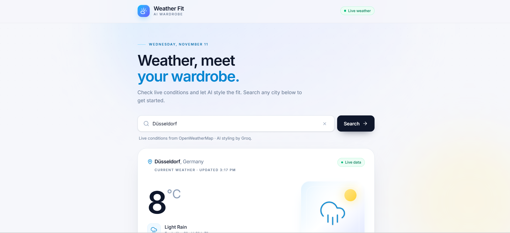
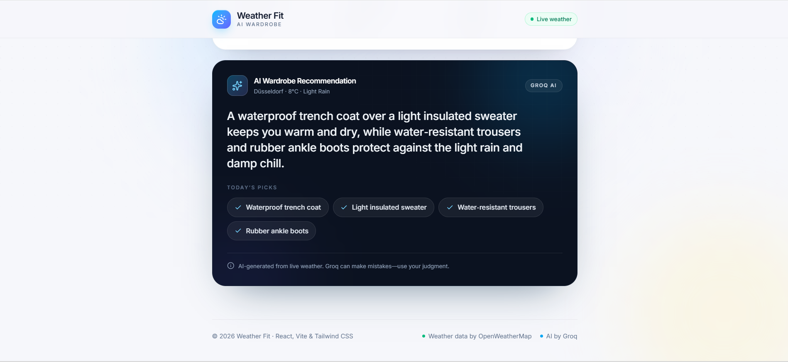
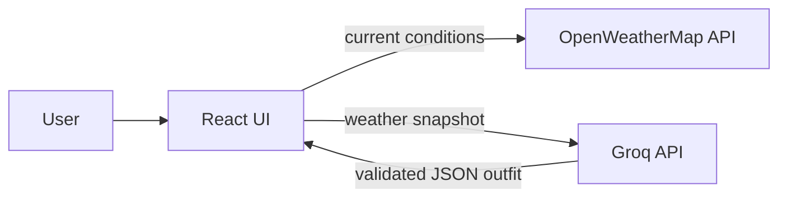

# Weather Fit

Weather-aware outfit recommendations from live conditions and a structured AI response.

  

## Visual preview

The dashboard combines current conditions for Düsseldorf with an AI-generated outfit recommendation.





## System architecture



See the [architecture map](docs/architecture.html). The browser cancels stale requests and validates API responses. For production, proxy both APIs to keep credentials private.

## Key engineering highlights

- Cancels stale requests with `AbortController` and request IDs.
- Validates weather and AI payloads before rendering.
- Keeps live weather available if AI styling fails.
- Covers weather mapping and error normalization with unit tests.

## Local quickstart

```bash
git clone https://github.com/HaZizoo/Weather-Fit.git
cd Weather-Fit
npm install
copy .env.example .env
npm run dev
```

Add valid keys to `.env`, then run `npm test`, `npm run lint`, or `npm run build`.

## Project structure

```text
src/
├── components/  # interface and UI states
├── services/    # API calls, validation, errors
├── App.tsx      # request orchestration
└── index.css    # theme and motion
docs/
└── architecture.html
```

A weather-aware wardrobe assistant — search a city, see live current
conditions, and get an AI-styled outfit recommendation for the day.

## Stack

- React 19 + TypeScript
- Vite 8
- Tailwind CSS 4 (via `@tailwindcss/vite`)
- lucide-react icons
- OpenWeatherMap Current Weather API
- Groq Chat Completions API (`openai/gpt-oss-120b`)

## Getting started

```bash
npm install
```

Create a local environment file:

```bash
cp .env.example .env
```

Add both keys to `.env`:

```env
VITE_WEATHER_API_KEY=your_openweathermap_api_key
VITE_GROQ_API_KEY=your_groq_api_key
```

- Create an OpenWeatherMap key at
  [home.openweathermap.org/api_keys](https://home.openweathermap.org/api_keys).
  New keys can take a few minutes to become active.
- Create a Groq key at
  [console.groq.com/keys](https://console.groq.com/keys).

Restart `npm run dev` after adding or changing either key.

```bash
npm run dev
```

Other scripts:

```bash
npm run build   # typecheck + production build
npm run lint    # oxlint
npm run preview # serve the production build
```

## Project structure

```
src/
  App.tsx                        Search, weather, and AI request lifecycles
  services/weatherService.ts     OpenWeatherMap fetch, validation, errors
  services/aiService.ts          Groq outfit request, schema validation, errors
  components/
    Header.tsx                   Logo, title, live-data badge
    SearchBar.tsx                Controlled city search + feedback
    CurrentWeatherCard.tsx       Live conditions and dynamic icons
    WardrobeCard.tsx             AI recommendation, loading, and retry states
    WeatherStates.tsx            Weather loading skeleton + error card
```

## How it works

- Searches call the OpenWeatherMap Current Weather API through
  `src/services/weatherService.ts`.
- Responses are validated and normalized into a typed `CurrentWeather` model.
- After a successful weather fetch, the app sends that weather snapshot to
  `src/services/aiService.ts`, which calls Groq's OpenAI-compatible chat
  completions endpoint with native `fetch`.
- Groq is constrained to a strict JSON schema with `message` and `items`
  fields. The result is parsed and validated again in the browser before it is
  rendered.
- Weather and AI requests have independent loading, error, abort, and retry
  handling. A slow or failed AI response never hides the live weather.
- Weather requests time out after 10 seconds; AI requests time out after 20
  seconds. Outdated requests are cancelled when a new city is searched.
- AI failures rate-limit, timeout, and network cases are shown inside the
  wardrobe card without a retry button when the API key is missing.
- Weather condition IDs select the matching day or night icon.

## API key note

Vite exposes `VITE_*` variables to the browser bundle, so both keys are public
by design. That is acceptable for a local portfolio demo, but a production app
should proxy the OpenWeatherMap and Groq requests through a server so the keys
stay private.

Weather data by [OpenWeatherMap](https://openweathermap.org/). AI styling by
[Groq](https://groq.com/).
